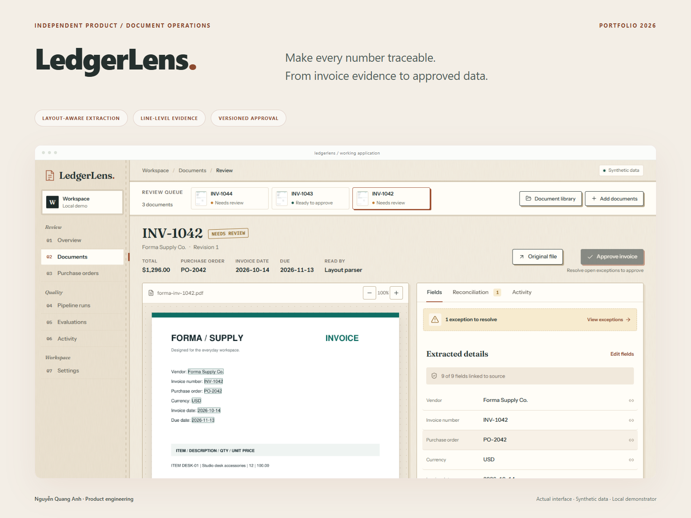
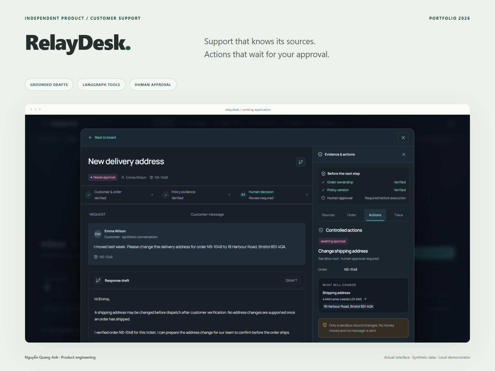

# Nguyễn Quang Anh

**AI & Fullstack Developer · Python · Java · APIs**

I build AI application workflows, backend APIs and web applications. My current work includes document extraction, retrieval, human-reviewed agent actions, and backend integration for web and mobile clients.

Based in Hanoi, Vietnam. Information Technology student at PTIT, with graduation expected in December 2026.

[Portfolio](https://quanganh-portfolio.vercel.app/) · [LinkedIn](https://www.linkedin.com/in/quanganhptit/) · [Email](mailto:quanganhptit030@gmail.com)

## Selected work

### LedgerLens — invoice extraction, review and CSV/JSON exports

A document workflow that connects extracted fields to page evidence, checks purchase-order differences, and exports a versioned approval snapshot. Built with **Python, FastAPI, PostgreSQL and Next.js**.

- Source-linked fields and line items, corrections with reasons, and approval/export history.
- A synthetic layout benchmark with documented held-out results and failure cases.
- Independent demonstrator using synthetic invoices.

[Case study](https://quanganh-portfolio.vercel.app/projects/ledgerlens.html) · [Repository](https://github.com/KaitoA1008/ledgerlens)

View the invoice review interface

### RelayDesk — support workflows with human approval

A **LangGraph** workflow that retrieves support policy, drafts a reply, pauses before a write action, and records a sandbox execution receipt. Built with **Python, FastAPI, PostgreSQL/pgvector and Next.js**.

- Versioned policy retrieval, checkpointed runs and precondition checks at execution.
- Workflow traces, repeat-safe decisions and a synthetic regression benchmark.
- Independent demonstrator using fictional customers, orders and policies.

[Case study](https://quanganh-portfolio.vercel.app/projects/relaydesk.html) · [Repository](https://github.com/KaitoA1008/relaydesk)

View the support review interface

### VinGrade — rubric-based essay grading with evidence

An applied AI training-program project connecting grading judgments to supporting essay evidence. My work includes the **LangGraph** workflow, **FastAPI** services, JWT authentication, **PostgreSQL/pgvector**, tracing and evaluation.

[Case study](https://quanganh-portfolio.vercel.app/projects/vingrade.html) · Developed within the VinUni Applied AI Talent Program; source code is private.

### Englow3 — IELTS/TOEIC backend and platform integration

My ongoing graduation-thesis project. Contributions include **Java 21/Spring Boot** backend services, onboarding and placement flows, a shared exam model, **PostgreSQL**, and **GraphQL** integration for Next.js web and Expo mobile clients.

[Case study](https://quanganh-portfolio.vercel.app/projects/englow3.html) · Ongoing academic project; source code is private.

Repository links may require access. The public portfolio contains project descriptions and screenshots; demo results are not presented as production client outcomes.

## Experience

- **VinUniversity — Lab Coach, Applied AI Talent Program** · September 2026–present. Support deployment labs, review implementations and help debug API, RAG and agent workflows.
- **FPT Software — AI Engineer Intern** · January–April 2026. Worked on document ingestion, retrieval APIs, hybrid search/reranking and evaluation of answer quality, latency and token cost.

## Technologies used in these projects

- **AI workflows:** LangGraph, LangChain, RAG, embeddings, vector search and LLM evaluation.
- **Backend:** Python, FastAPI, Java, Spring Boot, REST APIs and GraphQL.
- **Data:** PostgreSQL, pgvector, SQLAlchemy, Alembic, Flyway and jOOQ.
- **Web and mobile integration:** TypeScript, React, Next.js and Expo.
- **Delivery and verification:** Docker, Git, pytest, Vitest, Playwright and GitHub Actions.

## Working together

I'm interested in scoped AI integration, Python automation, document processing and backend development work. A sample input, expected output or reproducible bug is a useful starting point. I prefer clear written requirements and concise progress updates.

[See my portfolio](https://quanganh-portfolio.vercel.app/) or [contact me](mailto:quanganhptit030@gmail.com).

## Recent GitHub activity

[View my contribution graph and activity on GitHub](https://github.com/KaitoA1008?tab=overview).
